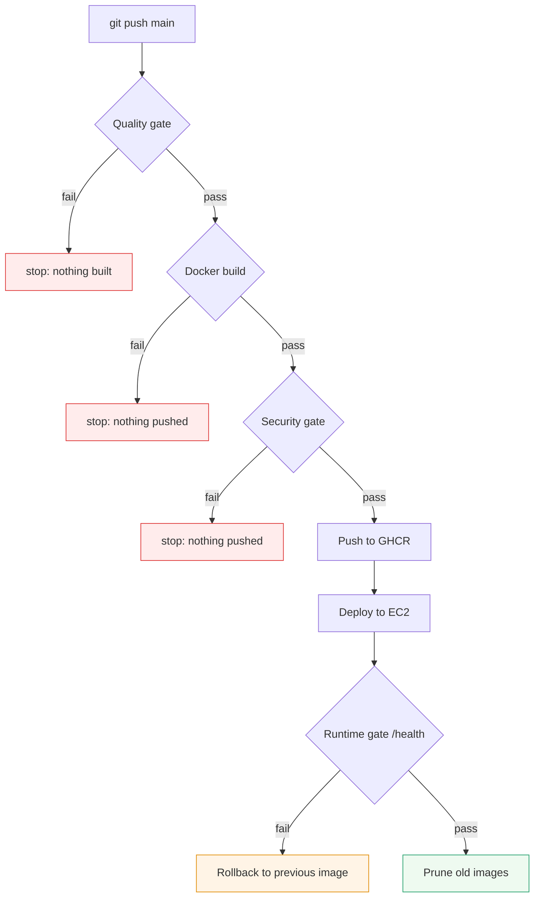
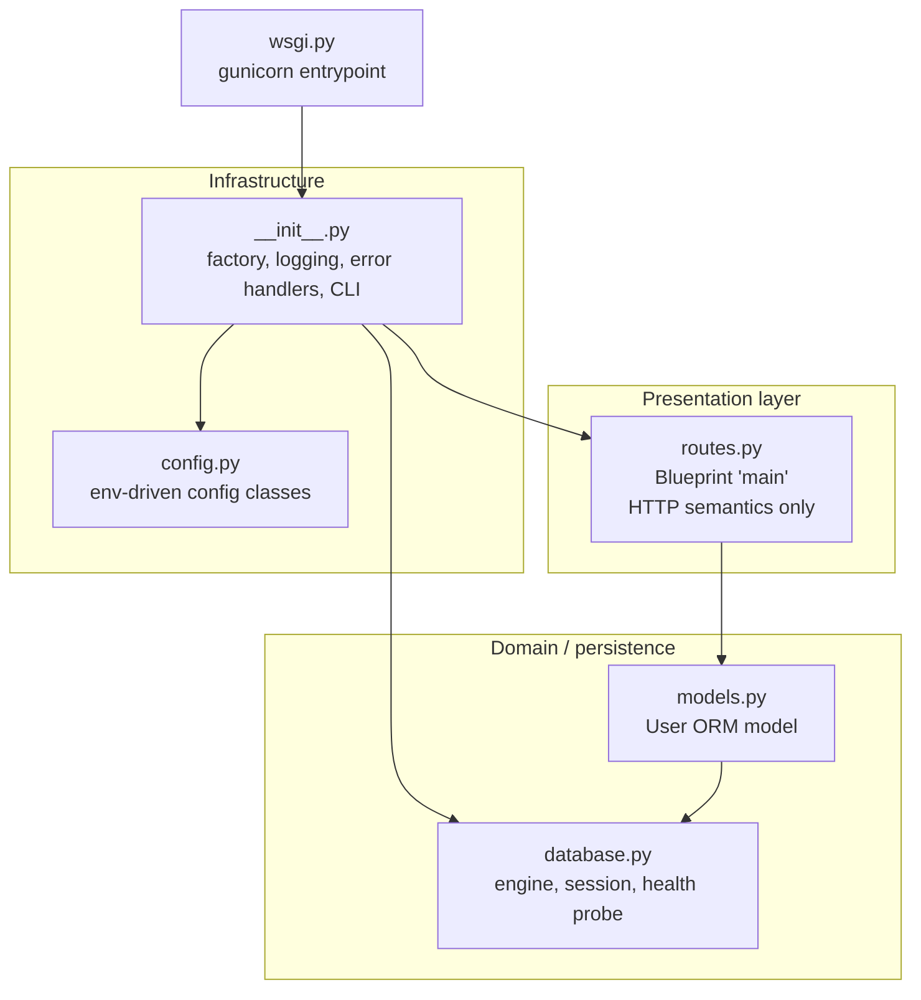
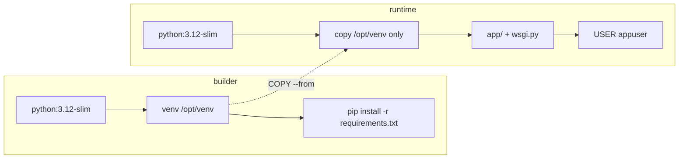
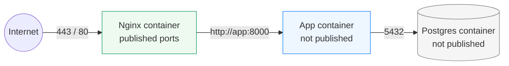
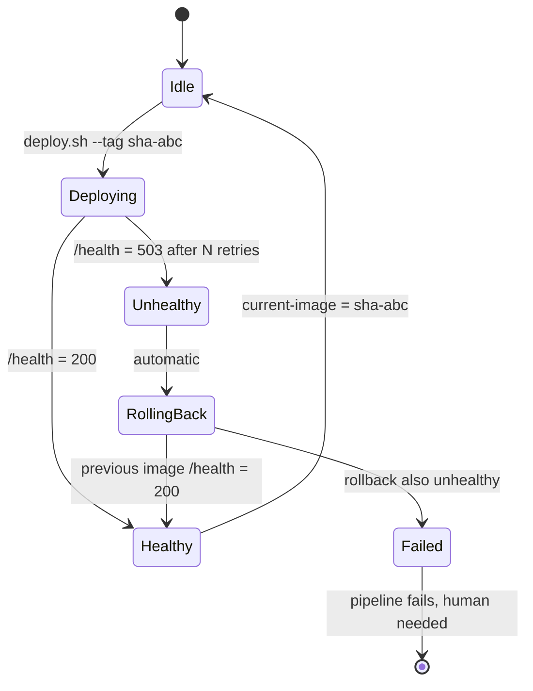
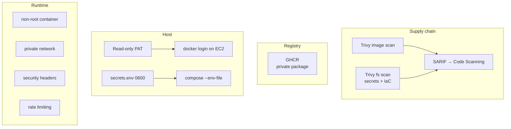

# 🏗️ Architecture Deep Dive

> A detailed explanation of *how* the system is designed and *why*. Written for
> a reader who wants to understand the reasoning — useful for interviews and
> for extending the project.

---

## 1. The three quality gates

The whole pipeline is built around three independent gates. Each one can stop a
release, and each one answers a different question.

| Gate | Question | Tool | Failure meaning |
|---|---|---|---|
| **Quality** | *Is the code correct and clean?* | Ruff + Black + ShellCheck + Pytest | The code is broken |
| **Security** | *Is the artefact safe to ship?* | Trivy (CVEs, secrets, misconfigurations) | The artefact is dangerous |
| **Runtime** | *Does it actually work?* | `/health` after deployment | The release does not work |



**Why three gates and not one?** Because they fail for different reasons and
are owned by different people. A developer owns the quality gate, a security
engineer owns the vulnerability gate, and the SRE owns the runtime gate. A
pipeline that only has "the tests pass" cannot protect a production system.

---

## 2. Application architecture

### 2.1 Layers



### 2.2 The application factory

```python
def create_app(config_name: str | None = None) -> Flask:
    app = Flask(__name__)
    app.config.from_object(get_config(config_name))   # 1. configuration
    configure_logging(app)                             # 2. logging
    init_db(app)                                      # 3. database
    _register_request_hooks(app)                      # 4. request ids
    _register_error_handlers(app)                     # 5. error handling
    _register_cli(app)                                # 6. CLI commands
    from app.routes import main_bp                     # 7. routes (imports models!)
    app.register_blueprint(main_bp)
    _auto_create_tables(app)                          # 8. schema
    return app
```

**Why a factory instead of a module-level `app`?**

* A module-level app is a **global singleton** — tests would share state and
  could not run in parallel.
* With a factory the test-suite creates a fresh instance per test with the
  `testing` configuration (in-memory SQLite) while production gets the
  `production` configuration — the same code, two configurations.
* Configuration becomes explicit: `create_app("testing")` instead of an
  environment variable that must be set before the import.

> **Subtle ordering requirement (a real bug found during development):**
> `app.routes` imports `app.models`, and the models must be registered with
> SQLAlchemy's metadata **before** `db.create_all()` runs. If the import
> happens later, the metadata is empty, `create_all()` silently creates
> nothing, and every query fails with `no such table: users` — while the log
> cheerfully says *"Database schema is up to date"*.
> The regression test `test_users_table_exists_right_after_startup` now guards
> this.

### 2.3 Configuration

```python
class BaseConfig:      # shared
class DevelopmentConfig(BaseConfig): DEBUG = True
class TestingConfig(BaseConfig):     SQLALCHEMY_DATABASE_URI = "sqlite:///:memory:"
class ProductionConfig(BaseConfig):  DEBUG = False
```

* **Twelve-Factor style**: everything that varies between environments comes
  from the environment, so one image runs everywhere.
* **Fail fast on a dangerous default**: `create_app` refuses to boot in
  production if `SECRET_KEY` is still the development placeholder.
* **The DSN is assembled safely**: the password is URL-encoded with
  `quote_plus`, so a password containing `@` or `/` cannot break the DSN.

### 2.4 The health endpoint — the most important route

```python
db_ok, db_error = check_database_connection()
return jsonify(payload), (200 if db_ok else 503)
```

Design decisions:

| Decision | Reason |
|---|---|
| It checks the **database**, not just the process | A web server that cannot reach its database is not healthy — it can only return errors |
| It returns **503**, not 500 | 503 = *temporarily unavailable* (the orchestrator should retry); 500 = *our bug* |
| It **never raises** | The probe catches every exception and converts it into a status — a failing probe must not crash the probe |
| It is **not cached** | The answer must reflect the current state, every time |
| It is **fast** | A single `SELECT 1` with a connection pool that has `pool_pre_ping=True` |
| The error message is **truncated** | A 300-character error field is enough to diagnose and short enough to log safely |

This single endpoint is the contract between the application and the entire
delivery system: the Docker `HEALTHCHECK`, the CI validation step and the
rollback logic all depend on it.

### 2.5 Error handling

| Situation | Response | Why |
|---|---|---|
| Unknown path | `404` JSON | A consistent API contract, never an HTML error page |
| Wrong method | `405` JSON | Tells the client what *is* allowed |
| Invalid JSON body | `400` JSON | The client can fix it |
| Wrong content type | `415` JSON | Explicit about the requirement |
| Validation failure | `400` with a list of messages | Actionable for the developer using the API |
| Duplicate e-mail | `409` | The conflict is with an existing resource, not with the request syntax |
| Database unreachable | `503` | Transient — the client should retry |
| Anything else | `500` with a **generic** message | The traceback is logged server-side, never sent to the client |

The 500 handler never leaks internals. That is both a security property
(no stack traces in the wild) and a professionalism signal.

---

## 3. Container architecture

### 3.1 Why multi-stage



**What the multi-stage build buys:**

1. **No build tools in the shipped image.** `gcc`, `make` and the Python
   headers never reach production → fewer packages → fewer CVEs.
2. **No pip in the shipped image.** The runtime cannot accidentally install
   something at start-up.
3. **Layer caching.** `requirements.txt` is copied before the source, so a
   code change rebuilds in seconds.
4. **Byte-compiled dependencies** (`compileall` in the builder) → faster cold
   start, no compiler in the runtime image.
5. **A clean ownership model.** The runtime image contains only the
   virtualenv and the application — nothing else.

### 3.2 Hardening decisions

| Decision | Implementation | Impact |
|---|---|---|
| Non-root user | `useradd --uid 10001 appuser` + `USER appuser` | A compromised process cannot write to the image |
| Read-only source | `COPY --chown=root:root` | The app cannot modify its own code |
| No shell | `--shell /usr/sbin/nologin` | No interactive login |
| No `curl` | health check uses `python -c urllib` | One less package to patch |
| Pinned base image | `python:3.12-slim` (a tag, updated on rebuild) | Reproducible enough; pin a digest for strictness |
| OCI labels | title, version, revision, source, license | `docker inspect` shows the provenance |
| `HEALTHCHECK` | in the image itself | `docker ps` shows the state, not just "Up" |
| Bounded Gunicorn | `--max-requests 1000 --max-requests-jitter 50` | No memory leak can grow forever |

### 3.3 Network topology



Only Nginx has published ports. The application and the database are reachable
**only** from inside the `devops-cicd-net` bridge network, by service name.
The AWS security group adds a second layer: 5432 and 8000 are not open in the
firewall at all.

---

## 4. Deployment architecture

### 4.1 The state machine



### 4.2 The two state files

| File | Written by | Read by | Purpose |
|---|---|---|---|
| `state/current-image` | `deploy.sh` (on success), `rollback.sh` | `deploy.sh`, `rollback.sh` | Which image is live |
| `state/previous-image` | `deploy.sh` (before deploying) | `rollback.sh` | The safety net |

They are plain text files on purpose: they are trivially inspectable, they
survive reboots, and they can be edited by hand in an emergency.

### 4.3 Why the lock file

`deploy.sh` takes an exclusive `flock` on `state/deploy.lock`. Without it,
two pipeline runs (for example a push to `main` while a manual deployment is
running) could interleave: run A saves the current image, run B saves it again,
and the "previous" pointer becomes wrong — the rollback would restore the same
broken version. The lock makes concurrent deployments impossible.

> **Subtlety found during integration testing:** a file descriptor opened with
> `exec 9>"$LOCK_FILE"` is **inherited by every child process**. If a child
> daemonises and outlives the script, the `flock` stays held and the *next*
> deployment fails with the confusing error *"Another deployment is already
> running"*. The fix is to close the descriptor in every child:
>
> ```bash
> compose() {
>     docker compose ... "$@" 9>&-     # <- the child does not inherit the lock
> }
> ```

### 4.4 Why the images are pruned only after success

```bash
# BEFORE: the previous image is still needed for a rollback.
compose pull app
compose up -d
health-check            # <- if this fails we roll back, so we must NOT prune yet
...
prune_images(...)       # <- only now, and the previous tag is explicitly kept
```

If the pruning happened before the health check, a failed deployment could not
roll back — the old image would already be gone. The prune function therefore
always keeps the current image **and** the previous one.

---

## 5. Security architecture



| Layer | Control | Where |
|---|---|---|
| Code | Ruff `S` rules, Trivy fs scan | CI |
| Image | Trivy CVE scan with `exit-code: 1` | CI |
| Registry | GHCR, private package, least-privilege PAT | GHCR |
| Transport | SSH key auth only, pinned host key | CI ↔ EC2 |
| Host | UFW (22/80/443), `fail2ban`, no password SSH | EC2 |
| Container | non-root, read-only source, health check | Docker |
| Network | no published DB/app ports, Docker bridge | Docker + AWS SG |
| Web | TLS 1.2/1.3, HSTS, CSP, rate limiting, `server_tokens off` | Nginx |
| Secrets | never in git, never in the image, never echoed | Everywhere |

### 5.1 Secret handling

```
GitHub Secret  --(env:)-->  runner step  --(ssh, password-stdin)-->  EC2
                                                                     |
EC2 secrets.env (0600, generated by setup-server.sh)  <--compose----+
```

* The GHCR token is piped to `docker login --password-stdin` over SSH and the
  remote Docker config is deleted immediately.
* `set -x` is never enabled in a step that touches a secret.
* GitHub masks secret values in the logs automatically.
* The production `SECRET_KEY` and the database password are **generated on the
  server** — they never travel through GitHub at all.

---

## 6. Why these choices (a summary)

| Choice | Alternative | Why this one |
|---|---|---|
| SHA tags for deployment | `latest` | `latest` is ambiguous — during a rollback you must know exactly what is running |
| Health check drives the rollback | "deploy and hope" | A deployment that is not verified is not a deployment |
| Previous image kept on disk | "pull it again if needed" | The image may have been deleted, or the registry may be unreachable during an incident |
| Multi-stage build | Single stage | 86 % smaller, far fewer CVEs |
| App factory | Module-level app | Testability and explicit configuration |
| `pool_pre_ping` | Plain pooling | Stale connections behind a load balancer are a classic outage cause |
| Health check queries the DB | `GET /` only | A process can be alive while its database is gone |
| `flock` in deploy.sh | No lock | Concurrent deployments corrupt the rollback pointer |
| Compose as the deployment tool | Ansible/Kubernetes | It is the tool the student will actually be asked about, and it is enough here |
